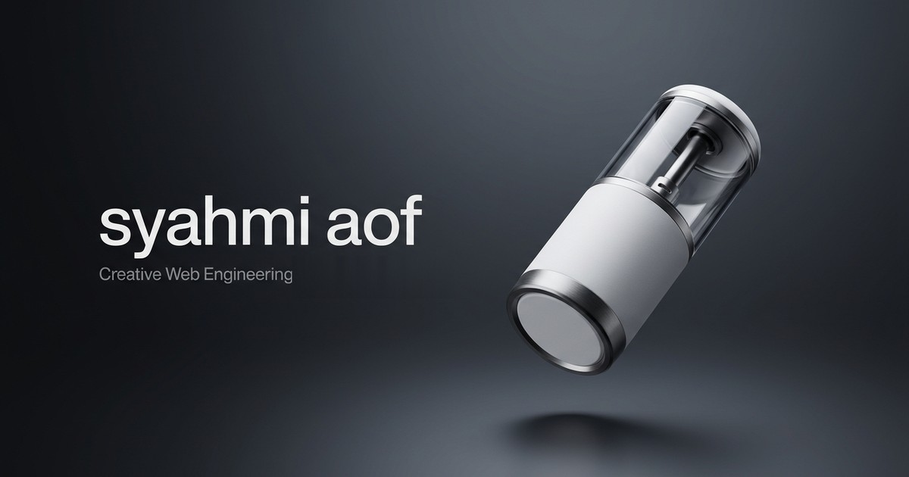

  <h1>syahmi-pod</h1>
  
<strong>syahmi aof — Interactive Dual-Canvas Product Animation & Scrollytelling Experience</strong>

  

    
    
    
    
  

  

    
    
    
    
  

---

  

---

## 🎧 Overview & Visual Engineering

**syahmi-pod** (`pod.syahmiaof.my`) is a high-performance interactive scrollytelling web application engineered by Muhammad Syahmi. It harnesses a synchronized dual-canvas rendering architecture to present photorealistic hardware product reveals and continuous 360-degree rotation scrubbed directly by the user's scroll position.

### Key Value Pillars:
- **Functionality**: Scrub-driven dual-engine canvas system providing seamless transitions between cinematic emergence (274 high-resolution 2200×1120 WebP frames) and interactive 360° product rotation (194 turntable frames) without layout jumps or dropped frames.
- **Aesthetic Excellence**: Organic capsule-to-fullscreen morphing, precision kinetic typography reveals with character-level SplitText animations, and a rich, atmospheric dark palette.
- **Business Impact**: Provides luxury hardware and consumer tech brands with an immersive product showcase that outperforms conventional video embeds through responsive, user-directed pacing.

---

## ⚙️ Architecture & Animation Mechanics

- **Dual-Engine Canvas Architecture**:
  - **Emergence Stage (Canvas 1)**: 274 WebP frames orchestrated via GSAP ScrollTrigger timeline interpolation with custom ease dampening.
  - **Turntable Stage (Canvas 2)**: 194 interactive rotation frames maintaining continuous rotational velocity and memory-efficient bitmap disposal.
- **Kinetic Layout Coordination**: Responsive pinning and scrubbed camera motion synchronized with Next.js static asset pipelines.
- **Technical Analysis**: For mathematical formulas, frame budgets, and bundle performance metrics, see **[BEDAH_TEKNIKAL.md](BEDAH_TEKNIKAL.md)**.

---

## 🚀 Live Production & Infrastructure

- **Live Production URL**: [https://pod.syahmiaof.my](https://pod.syahmiaof.my)
- **Deployment Platform**: Vercel Global Edge Network with Cloudflare DNS
- **Continuous Validation**: Automated GitHub Actions CI workflow executing syntax and build integrity checks on every commit.

---

## 📄 License & Intellectual Property

Proprietary Software. Copyright &copy; 2026 Muhammad Syahmi (`syahmiaof`). All rights reserved.  
Created solely for demonstration and portfolio showcase purposes. See [LICENSE](LICENSE) for details.
